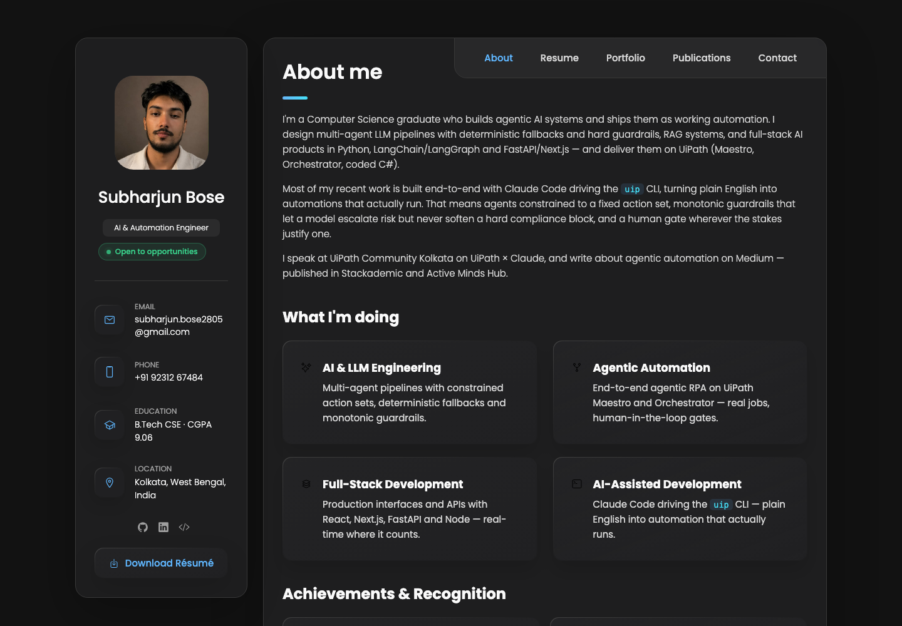
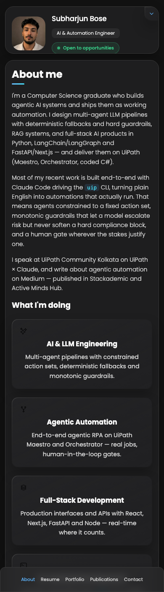

# Subharjun Bose — Personal Portfolio

A fully responsive personal portfolio for an AI / Automation Engineer, built with plain HTML, CSS and
JavaScript. No build step, no dependencies — open `index.html` and it runs.

**Live:** https://mango-flower-081e23900.7.azurestaticapps.net
(target domain: knowsubharjun.com — not yet registered)




## Contents

| Page | What's on it |
| --- | --- |
| About | Summary, focus areas, achievements, tech stack |
| Resume | Education, six roles, six technical-skill groups |
| Portfolio | Nine projects, filterable by discipline |
| Talks | Two UiPath Community sessions, technical writing, paper, workshop, meetup |
| Contact | Map and a working contact form |

## Running it locally

```bash
git clone https://github.com/Subharjun/subharjunbose.git
cd <repo-name>
python3 -m http.server 8000
```

Then open http://localhost:8000. Opening `index.html` directly works too, though a local server is
closer to how it behaves when deployed.

## Deploying

Hosted on Azure Static Web Apps (Free tier — includes TLS and custom domains).

```bash
az login          # once; needs a browser because the tenant enforces MFA
./deploy-azure.sh
```

The script creates the resource group and Static Web App if they don't exist, then uploads the
site and prints the live URL. Re-run it to publish changes.

### Custom domain

Once you own the domain, point DNS at the app and register it:

```bash
az staticwebapp hostname set -n knowsubharjun -g rg-knowsubharjun --hostname www.knowsubharjun.com
```

Azure issues and renews the certificate automatically.

## Structure

```
index.html                     all five pages; they're toggled, not routed
staticwebapp.config.json       Azure SWA routing, caching and security headers
deploy-azure.sh                one-command deploy
index.txt                      plain-text mirror of every string, for editing copy
assets/css/style.css           one stylesheet, driven by custom properties in :root
assets/js/script.js            nav, filtering, modal, form
assets/images/projects/        generated project cards (SVG)
```

### Customising

- **Colours** live as custom properties at the top of `style.css` — `--accent-primary`,
  `--accent-cyan` and the gradients re-theme the whole site.
- **Navigation** matches on `data-nav-target` against `data-page`, so renaming a nav label is safe.
- **Portfolio filters** match on `data-filter-value` against `data-category`, likewise.
- Deep links work: `#resume`, `#portfolio`, `#talks`, `#contact`.

## Credits

Built on the [vCard personal portfolio](https://github.com/codewithsadee/vcard-personal-portfolio)
template by [codewithsadee](https://github.com/codewithsadee), substantially restyled and rewritten.

## License

MIT — see [LICENSE](./LICENSE). The original template's copyright notice is retained alongside mine.
